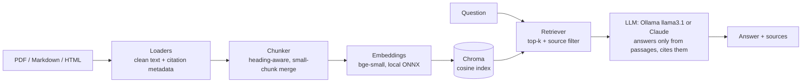

# RAG Knowledge Retrieval Pipeline

Document ingestion, chunking, embeddings and vector search over real enterprise content, with
grounded, cited answers from a local LLM (Ollama) or Claude. Built with LangChain, Chroma and FastEmbed.



## What's inside

| Stage | Module | Notes |
|---|---|---|
| Ingestion | `ragpipe/loaders.py` | PDF (one doc per page, running headers/footers removed), Markdown (front matter and Hugo shortcodes stripped), HTML (main content only). Every document gets `source`, `title`, `page`, `page_url` metadata. |
| Chunking | `ragpipe/chunking.py` | Recursive splitter that breaks at headings, then paragraphs, then sentence ends. Chunks under 200 characters are merged into a neighbour. Each chunk gets a title header and a stable ID (re-ingesting replaces chunks, never duplicates them). |
| Embeddings | `ragpipe/embeddings.py` | `BAAI/bge-small-en-v1.5` via FastEmbed (ONNX on CPU, no API key), with separate query and passage encoders. |
| Vector search | `ragpipe/store.py` | Persistent Chroma with cosine distance, top-k search, per-document filter. |
| Grounded Q&A | `ragpipe/qa.py`, `ragpipe/llm.py` | The LLM answers only from numbered passages and cites them, or says the documents don't cover the question. Provider is switchable: **Ollama** (default, local, free) or **Claude** (`claude-opus-5-5`, adaptive thinking, server-side refusal fallback). |
| Evaluation | `ragpipe/evaluate.py`, `eval/questions.jsonl` | hit-rate@k, MRR and answer-in-context (free); answer match and LLM-judged faithfulness (optional). |
| Interfaces | `ragpipe/cli.py`, `ragpipe/api.py` | `ragpipe` CLI and a FastAPI service (`/ingest`, `/query`, `/search`, `/sources`). |

## Data: real, public documents

`data/sources.json` lists 12 real documents. `scripts/download_corpus.py` fetches them into `data/raw/`; they aren't committed.

| Source | Format | License |
|---|---|---|
| [GitLab Handbook](https://handbook.gitlab.com/): values, travel & expense policy, spending company money, confidentiality levels, password guidelines, ransomware response, acceptable use, anti-harassment, mission, time-off types | Markdown, HTML | [CC BY-SA 4.0](https://creativecommons.org/licenses/by-sa/4.0/), © GitLab B.V. |
| [NIST Cybersecurity Framework 2.0](https://doi.org/10.6028/NIST.CSWP.29) (CSWP 29) | PDF, 32 pages | Public domain (U.S. Government work) |
| [NIST SP 800-63B-4](https://doi.org/10.6028/NIST.SP.800-63B-4), Digital Identity Guidelines: Authentication | PDF, 129 pages | Public domain (U.S. Government work) |

Together: 12 files, 171 pages/docs, **897 chunks**.

## Quickstart (Windows)

Prerequisites: Python 3.11 or 3.12, and [Ollama](https://ollama.com) with a tool-capable model:

```bash
ollama pull llama3.1:8b
```

Then:

```bash
py -3.12 -m venv .venv
```
```bash
.venv\Scripts\activate
```
```bash
pip install -e ".[dev]"
```
```bash
python scripts/download_corpus.py
```
```bash
ragpipe ingest data/raw
```
```bash
ragpipe ask "How long do I have to submit an expense report?"
```

No API key is needed. To use Claude instead, copy `.env.example` to `.env` and set
`RAG_PROVIDER=anthropic` and `ANTHROPIC_API_KEY`.

Other commands: `ragpipe search "<query>"` (retrieval only), `ragpipe sources`, `ragpipe eval`,
`ragpipe serve` (API docs at http://127.0.0.1:8000/docs).

## Evaluation

`eval/questions.jsonl` has 17 questions about the corpus. Each one names the document(s) that answer it
and key phrases the answer must contain. The questions were hand-written; every expected phrase was
checked against the downloaded source text.

```bash
ragpipe eval                    # retrieval metrics, free
ragpipe eval --answers --judge  # + answer match and faithfulness (LLM calls)
```

Current results (k=5, chunk 1000 / overlap 150, `llama3.1:8b` on an RTX 4060 laptop GPU):

| hit_rate@5 | MRR | answer_in_context | answer_match | faithfulness |
|---|---|---|---|---|
| 1.00 | 0.97 | 0.88 | 0.88 | 1.00* |

\* judged by the same 8B model, so treat it as an upper bound.

- **answer_in_context** is the strictest retrieval metric: do the top-5 chunks contain the answer text?
  The two misses ("six functions of CSF 2.0", "minimum password length") retrieve the right document
  but not the exact passage. In both cases the model answered "the documents don't cover it" rather
  than guessing.
- **Header/footer stripping and small-chunk merging** cut wasted top-5 slots (tiny header-only
  chunks) from 11/85 to 0/85. Measured by rebuilding the index with and without the fix.

## Next improvements (measure each with `ragpipe eval`)

- Cross-encoder reranking (retrieve 20, rerank, keep 5): targets both current misses.
- Hybrid search: BM25 keyword retrieval fused with vectors, for exact terms like "15 characters".
- A stronger or different judge model for faithfulness; a bigger eval set, including unanswerable questions.

## Tests

```bash
pytest
```

12 tests, all offline: fake embeddings and a fake chat model, so no model download, Ollama or API key needed.

## Related

[agentic-doc-assistant](../agentic-doc-assistant) builds a LangGraph agent on top of this pipeline.
